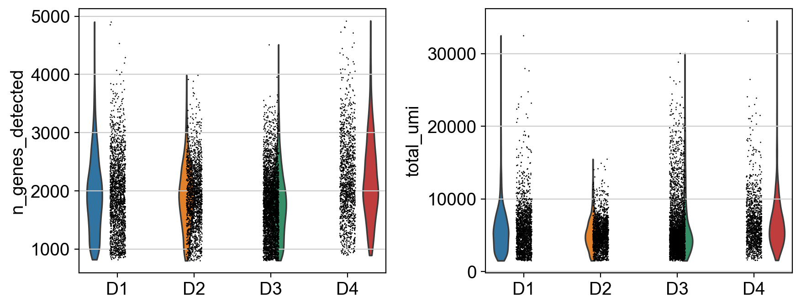
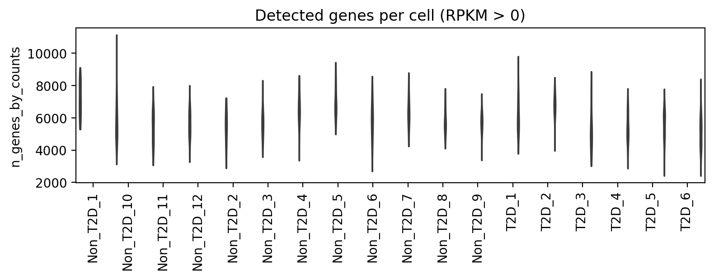

## 本章目标

1. 知道 QC 看哪些指标，以及每个指标异常意味着什么；
2. 会对自己的数据画分布、定阈值，而不是背“20%”；
3. 复现本教程的 QC 结果：8,569 → 8,531 个细胞。

<div class="callout why" markdown="1">
<span class="callout-title">为什么 QC 不能“默认参数一路点”</span>
QC 阈值直接决定你保留哪些细胞。阈值太松，空液滴/死细胞/双细胞会形成假簇；阈值太严，真实但脆弱的细胞类型（如内分泌细胞、应激细胞）会被删掉。**先看分布，再定阈值，并记录删了多少、为什么删**。
</div>

## 5.1 看哪些指标

| 指标 | 说明 | 异常提示 |
|---|---|---|
| 检测基因数（nGene） | 每个细胞检测到的基因数 | 过低：空液滴/死细胞；过高：双细胞 |
| UMI 总数 | 每个细胞的 counts | 过低：文库失败；过高：双细胞 |
| 线粒体比例 | MT- 基因 counts 占比 | 过高：细胞应激/死亡 |
| 双细胞评分 | Scrublet/scDblFinder | 双细胞会形成“混合”簇 |
| 环境 RNA | SoupX/CellBender | 外泌/裂解 RNA 污染 |
| 复杂度 | 基因数/UMI 的关系 | 低复杂度提示异常 |

## 5.2 本教程的实际情况

<div class="callout warn" markdown="1">
<span class="callout-title">这两个处理后矩阵都没有 MT- 基因</span>
GSE84133 的矩阵只保留 20,125 个蛋白编码基因，`MT-` 基因不在里面；GSE81608 也没有。因此**不能**计算线粒体比例，也不要在报告里写“mito < 20%”。这不是流程缺失，是数据层级的限制。
</div>

GSE84133 的 QC 规则：

```python
sc.pp.calculate_qc_metrics(adata, qc_vars=["mt"], inplace=True)
sc.pp.filter_cells(adata, min_genes=800)
sc.pp.filter_cells(adata, min_counts=1500)
sc.pp.filter_cells(adata, max_genes=5000)
sc.pp.filter_genes(adata, min_cells=3)
```

为什么是 800 / 1,500 / 5,000？

- 8,569 个细胞的 nGene 第 1 百分位约 845，UMI 第 1 百分位约 1,624；800/1,500 只删除极低质量细胞。
- max_genes=5,000 去掉少数“基因数异常高”的潜在双细胞；实际最大值 4,922，基本不删。
- 基因在 ≥3 个细胞表达，去掉几乎全 0 的基因。

**预期输出**：

```text
before QC: (8569, 20125)
after QC: (8531, 16353)
```

8,531 / 8,569 = **99.6%** 保留；基因从 20,125 降到 16,353。

GSE81608 的 QC：

- 1,600 个细胞全部检测到 >2,400 个基因；
- 没有 MT- 基因，无法算 mito%；
- 没有空液滴/原始 barcode，无法做 EmptyDrops/Scrublet；
- 因此**不删细胞**，只记录 QC。

## 5.3 看图：什么样的分布算“有问题”



<figcaption>GSE84133 质控后的 nGene 与 UMI 分布（按供者）。</figcaption>



<figcaption>GSE81608 每个细胞检测到的基因数（RPKM > 0）。</figcaption>

你应该看：

- 是否有某个供者整体偏低？——可能是批次/建库质量，不一定是 biology。
- 是否有小峰在极高 nGene？——可能是双细胞。
- 是否有细胞 nGene 极低但仍有少量 counts？——可能是空液滴/死细胞。
- 删除前后细胞类型比例是否剧烈变化？——如果某个类型被大量删掉，阈值可能过严。

## 5.4 双细胞与环境 RNA：本教程没做，但你必须知道

- **双细胞**：两个细胞被同一个液滴包住，表达谱是两种细胞的混合。Scrublet/scDblFinder 可以打分；需要原始 barcode 矩阵或至少足够的基因数。
- **环境 RNA**：细胞裂解后释放的 RNA 被其他液滴捕获，导致“所有细胞都表达某个 marker”。SoupX/CellBender 可以校正。
- 处理后矩阵通常没有空液滴/raw barcode，做不了这些；在生产级分析里应回到原始数据。

<div class="callout expected" markdown="1">
<span class="callout-title">你应该看到</span>
- GSE84133：`before QC: (8569, 20125)` → `after QC: (8531, 16353)`；
- GSE81608：1,600 个细胞全部保留；
- `baron_qc_violin.png` 和 `gse81608_qc_genes.png` 与上图一致；
- 没有线粒体图——这是正常的，不要补一个假的。
</div>

## 5.5 排错表

| 现象 | 可能原因 | 处理 |
|---|---|---|
| 细胞删得太多（<80%） | 阈值按别的组织套 | 看分布，放宽 min_genes/min_counts |
| 某个细胞类型消失 | 该类型 nGene 偏低被删 | 分类型看 QC，必要时按类型设阈值 |
| 所有细胞 mito% = 0 | 矩阵没有 MT- 基因 | 不要算；回到原始 counts |
| 双细胞簇 | 未做双细胞检测 | 用 Scrublet/scDblFinder 在原始数据上做 |
| 所有细胞一个簇 | 归一化/scale 错，或 QC 后基因太少 | 检查 `X` 是否 log、HVG 是否选对 |

<div class="callout check" markdown="1">
<span class="callout-title">检查点</span>
**Q1**：为什么本教程没有线粒体比例图？

**Q2**：如果 min_genes=2000，会有什么风险？

**Q3**：QC 后基因数从 20,125 降到 16,353，是删了 3,772 个“坏基因”吗？

<details><summary>参考答案</summary>

1. 两个处理后矩阵都不含 MT- 基因，无法计算；不是所有组织/矩阵都能算 mito%。
2. 会删掉大量真实但低复杂度的细胞（如内分泌细胞/应激细胞），改变细胞类型比例。
3. 不是“坏基因”，是“在 ≥3 个细胞中都没有表达”的基因；它们对聚类/DE 没有信息，删掉减少多重检验负担。

</details>
</div>

## 下一步

QC 之后，下一步把不同细胞放到同一把尺子上：counts 用 CP10k + log1p，RPKM 用 log2(x+1)，然后选 2,000 个高变基因。
