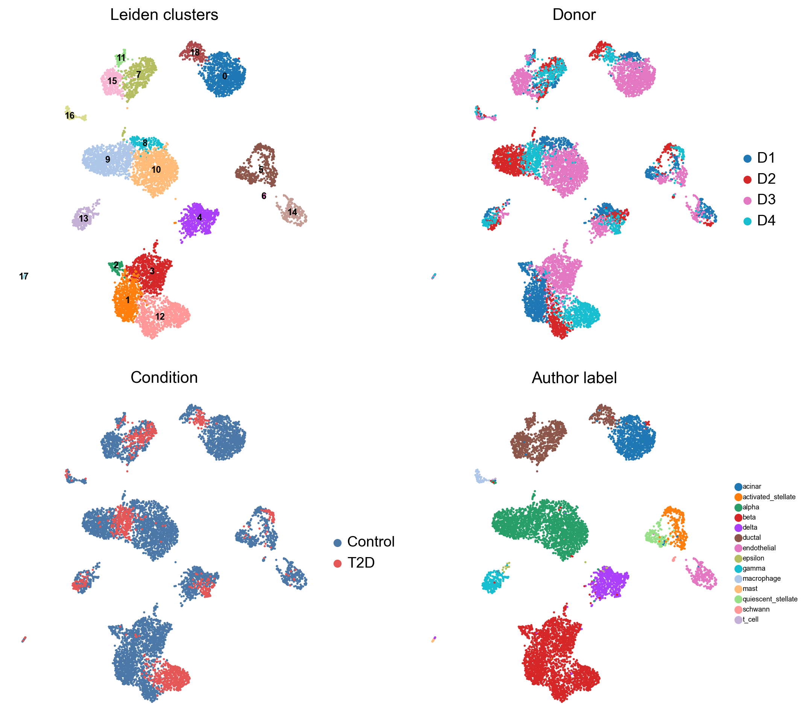

## 本章目标

1. 理解 PCA → kNN → UMAP → Leiden 的顺序和每个参数；
2. 能解释“19 个簇不是 19 种细胞类型”；
3. 判断什么时候需要批次校正，什么时候不要。

<div class="callout why" markdown="1">
<span class="callout-title">为什么先 PCA 再聚类</span>
直接在 2 万个基因上算距离，会被噪声和高表达基因主导。PCA 把表达压缩到几十个主成分，保留主要变异；kNN 在低维空间构建“细胞相似图”；Leiden 在图上找社区。UMAP 只是把图可视化，**不参与聚类**。
</div>

## 7.1 标准顺序

```python
sc.tl.pca(adata, n_comps=50, svd_solver="arpack", random_state=42)
sc.pp.neighbors(adata, n_neighbors=15, n_pcs=30, random_state=42)
sc.tl.umap(adata, random_state=42)
sc.tl.leiden(adata, resolution=0.6, random_state=42,
             flavor="igraph", n_iterations=2, directed=False)
```

| 参数 | 作用 | 本教程 |
|---|---|---|
| `n_comps=50` | PCA 保留 50 个主成分 | 取前 30 个做 kNN |
| `n_neighbors=15` | 每个细胞的邻居数 | 15；太大合并小簇，太小碎片化 |
| `resolution=0.6` | Leiden 粒度 | Baron 0.6；GSE81608 0.4 |
| `random_state=42` | 随机种子 | 保证可复现 |

## 7.2 本教程的结果

| | GSE84133 | GSE81608 |
|---|---|---|
| resolution | 0.6 | 0.4 |
| 簇数 | **19** | **8** |
| 合并后类型 | 11 | 4 |

GSE84133 的 19 个簇：

- β 细胞 4 簇（1、2、3、12），其中簇 2 高表达 DDIT3/HSPA5/HERPUD1，是 ER 应激状态；
- α 细胞 3 簇（8、9、10）；
- ductal 4 簇（7、11、15、18），其中 18 是 REG+；
- 其余为 acinar、δ、PP、stellate、schwann、endothelial、macrophage、mast。

GSE81608 的 8 个簇：

- α 细胞被拆成 5 簇（0、2、3、4、5）；
- β、δ、PP 各 1 簇；
- 合并注释为 4 类。

**聚类数不等于细胞类型数。** 簇是“表达相似的细胞群”，可能是同一类型的亚状态、供者/批次差异，也可能是过聚类。必须用 marker 注释后再决定合并。



<figcaption>GSE84133 的 UMAP：按 Leiden 簇、供者、疾病、作者标签着色。可以看到 D4（T2D）在 β 细胞区域富集，但这与供者共线，不能直接解释为疾病效应。</figcaption>

## 7.3 怎么选 resolution

- 先跑 0.4 / 0.6 / 0.8 三个值，比较簇数和 marker；
- 如果多个 resolution 下同一群细胞稳定分开，说明结构稳健；
- 如果只在 1.2 出现、marker 又不特异，可能是过聚类；
- 不要用“能讲出故事”的 resolution 反推参数。

一个实用检查：

```python
for res in [0.4, 0.6, 0.8, 1.0]:
    sc.tl.leiden(adata, resolution=res, key_added=f"leiden_{res}",
                 flavor="igraph", n_iterations=2, directed=False)
    print(res, adata.obs[f"leiden_{res}"].nunique())
```

## 7.4 批次：什么时候校正，什么时候不要

本教程**没有**做 Harmony/ComBat，因为 GSE84133 的 T2D 状态与 D4 供者完全共线：

- 如果按供者做 Harmony，可能把 D4 的疾病信号一起删掉；
- 如果观察到同一细胞类型按供者分开，先判断是技术批次还是真实个体差异；
- 跨数据集整合才考虑 Harmony/scVI/BBKNN，并且要在**不包含疾病标签**的嵌入上评估混合。

> 经验法则：批次校正的目的是让同一细胞类型在不同批次对齐，不是让疾病分组消失。分组与批次共线时，“校正后差异消失”可能是过校正。

## 7.5 预期结果与排错

<div class="callout expected" markdown="1">
<span class="callout-title">你应该看到</span>
- GSE84133：`leiden` 有 19 个类别，最大簇约 1,135 个细胞；
- GSE81608：`leiden` 有 8 个类别，α 细胞占多数；
- UMAP 上同类细胞聚在一起，但不同供者会有一定混合；
- 没有“所有细胞挤成一团”或“每个细胞一个簇”。
</div>

| 现象 | 可能原因 | 处理 |
|---|---|---|
| 所有细胞一个簇 | 未归一化/未 log，或 HVG 太少 | 检查 `X` 分布、HVG 数 |
| 每个供者一簇 | 强批次效应 | 检查 donor 着色；考虑 Harmony，但注意共线 |
| 每个细胞一个簇 | resolution 太高/邻居太少 | 降 resolution，增 n_neighbors |
| `LLVM ERROR: __svml_sqrtf16` | numba/llvmlite 在 Windows 的 SVML 问题 | 设置 `NUMBA_DISABLE_INTEL_SVML=1` |
| `ModuleNotFoundError: leidenalg` | 未安装 | `pip install leidenalg igraph` |

<div class="callout check" markdown="1">
<span class="callout-title">检查点</span>
**Q1**：UMAP 上的距离能直接当“分化距离”吗？

**Q2**：为什么 GSE81608 的 α 细胞被拆成 5 簇，却不代表 5 种 α 细胞？

**Q3**：什么情况下应该做 Harmony？本教程为什么不做？

<details><summary>参考答案</summary>

1. 不能。UMAP 主要保留局部邻接关系，全局距离/簇间距离不可靠；要看 marker 和独立验证。
2. 可能是供者/技术差异或过聚类；marker 仍指向 α，合并为一种类型更合理。
3. 当同一细胞类型在不同批次明显分开、且批次与生物学不共线时。本教程疾病与供者共线，校正可能删掉疾病信号，所以不做。

</details>
</div>

## 下一步

聚类只是“分组”。下一步用 marker 给每个簇命名，并用作者标签做独立验证；GSE84133 的 ARI 会达到 0.968。
