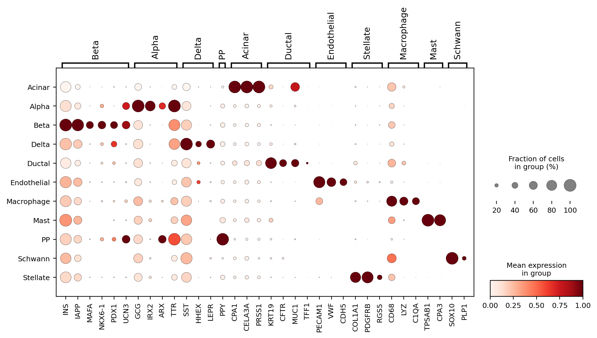
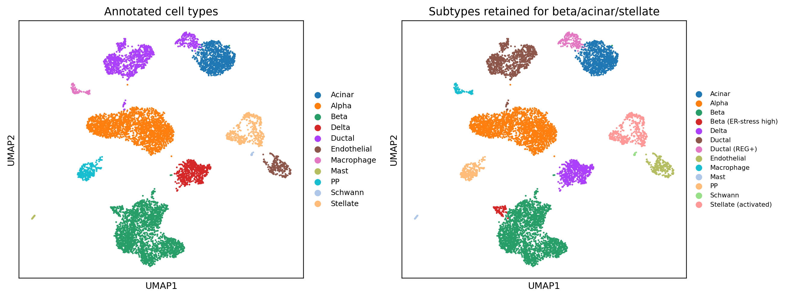

## 本章目标

1. 会用 dotplot/表达量给簇挑 marker；
2. 能把 19 个簇合并成 11 类细胞；
3. 会用独立标签（作者注释）计算 ARI，而不是自说自话。

<div class="callout why" markdown="1">
<span class="callout-title">为什么注释不能只看一个 marker</span>
INS 高表达不一定是 β 细胞：可能是双细胞、环境 RNA、或胰岛素瘤。可靠注释需要**一组 marker 相互印证**，并结合簇的整体表达、作者标签、组织学/蛋白验证。注释是“有置信度的假说”，不是绝对真理。
</div>

## 8.1 Canonical marker

| 类型 | 关键 marker |
|---|---|
| β | INS, IAPP, MAFA, NKX6-1, PDX1, UCN3, SLC2A2 |
| α | GCG, IRX2, ARX, TTR |
| δ | SST, HHEX, LEPR |
| PP（γ） | PPY |
| 腺泡 | CPA1, CELA3A, PRSS1, AMY2A |
| 导管 | KRT19, CFTR, MUC1, TFF1；REG+：REG3A, OLFM4, REG1A |
| 内皮 | PECAM1, VWF, CDH5 |
| 星状 | COL1A1, PDGFRB, RGS5, ACTA2 |
| 巨噬 | CD68, LYZ, C1QA |
| 肥大 | TPSAB1, CPA3 |
| Schwann | SOX10, PLP1, S100B |

```python
markers = {
    "Beta": ["INS", "IAPP", "MAFA", "NKX6-1", "PDX1", "UCN3"],
    "Alpha": ["GCG", "IRX2", "ARX", "TTR"],
    "Delta": ["SST", "HHEX", "LEPR"],
    "PP": ["PPY"],
    "Acinar": ["CPA1", "CELA3A", "PRSS1"],
    "Ductal": ["KRT19", "CFTR", "MUC1", "TFF1"],
}
sc.pl.dotplot(adata, markers, groupby="leiden",
              standard_scale="var", use_raw=True)
```



<figcaption>最终 11 类细胞的 marker dotplot。点大小=表达该基因的细胞比例，颜色=组内平均表达（按基因标准化）。</figcaption>

## 8.2 簇到类型的映射

| 簇 | 注释 | 关键证据 |
|---|---|---|
| 1, 3, 12 | β | INS/IAPP/MAFA/NKX6-1/PDX1 |
| 2 | β（ER 应激高） | DDIT3, HSPA5, HERPUD1, TRIB3 |
| 8, 9, 10 | α | GCG, IRX2, ARX, TTR |
| 4 | δ | SST, HHEX, LEPR |
| 13 | PP | PPY |
| 0 | 腺泡 | CPA1, CELA3A, PRSS1 |
| 7, 11, 15, 18 | 导管 | KRT19, CFTR, MUC1；18 为 REG+ |
| 5 | 星状 | COL1A1, PDGFRB, RGS5 |
| 6 | Schwann | SOX10, PLP1 |
| 14 | 内皮 | PECAM1, VWF, CDH5 |
| 16 | 巨噬 | CD68, LYZ, C1QA |
| 17 | 肥大 | TPSAB1, CPA3 |

## 8.3 用作者标签做独立验证

作者标签不是 ground truth，但它是一个**独立于我们聚类和 marker 选择**的参考。计算 ARI：

```python
from sklearn.metrics import adjusted_rand_score
ari = adjusted_rand_score(adata.obs["author_label"],
                          adata.obs["cell_type"])
print(ari)   # 0.968
```

**预期输出**：

```text
ARI vs author labels: 0.968
```

ARI 接近 1 说明两种分组高度一致；但要注意：

- ARI 高不代表注释“正确”，只代表和作者标签一致；
- 作者标签也可能错，尤其是稀有类型/双细胞；
- 要看混淆矩阵，而不是只看一个数。

GSE84133 的混淆矩阵大致是：

| 预测 \ 作者 | acinar | alpha | beta | delta | ductal | ... |
|---|---:|---:|---:|---:|---:|---:|
| Acinar | 940 | 1 | 8 | 2 | 5 | ... |
| Alpha | 0 | 2282 | 9 | 1 | 1 | ... |
| Beta | 0 | 1 | 2486 | 7 | 4 | ... |
| Ductal | 8 | 12 | 2 | 0 | 1061 | ... |

GSE81608 的 ARI = **0.856**，主要因为 α 细胞被拆成 5 个 Leiden 簇；合并后仍是 4 类。



<figcaption>注释后的 UMAP。左：11 类细胞；右：保留 β/ductal/stellate 的亚状态。</figcaption>

## 8.4 稀有类型：不要假装没看见

作者在 GSE84133 中标注了：

- ε 细胞：18 个；
- T 细胞：7 个。

在当前 resolution 下，它们没有形成独立簇：ε 被 β 吸收，T 细胞被巨噬细胞簇吸收。这是**样本量/分辨率的限制**。正确写法是：

> “当前聚类未将 ε 细胞和 T 细胞分辨为独立群；作者标签中存在 18 个 ε 和 7 个 T 细胞，提示稀有类型需要更高分辨率或靶向富集验证。”

不要为了“完整”硬说“我们鉴定了 ε 细胞”。

<div class="callout expected" markdown="1">
<span class="callout-title">你应该看到</span>
- GSE84133：11 类细胞；ARI 0.968；
- GSE81608：4 类细胞；ARI 0.856；
- dotplot 中 β 的 INS/IAPP、α 的 GCG、δ 的 SST、PP 的 PPY 清晰；
- 没有把所有干细胞/免疫细胞强行归到一个“other”。
</div>

## 8.5 注释的常见错误

| 错误 | 后果 | 修复 |
|---|---|---|
| 用同一个 marker 聚类又“验证” | 循环论证 | 用独立标签/蛋白验证 |
| 只看一个 marker | 双细胞/环境 RNA 误判 | 一组 marker + 簇整体表达 |
| 把作者标签当 ground truth | 继承作者错误 | 把它当参考，保留置信度 |
| 强行解释每个亚簇 | 过拟合噪声 | 合并稳定亚群，报告不确定性 |
| 忽略稀有类型 | 漏掉重要细胞 | 提高分辨率/靶向验证 |

<div class="callout check" markdown="1">
<span class="callout-title">检查点</span>
**Q1**：ARI=0.968 说明你的注释一定正确吗？

**Q2**：为什么簇 2 被标成“β（ER 应激高）”，而不是一种新细胞类型？

**Q3**：如果作者标签和你的注释冲突，应该信谁？

<details><summary>参考答案</summary>

1. 不。ARI 只说明与作者标签一致；作者标签也可能错，且 ARI 对稀有类型不敏感。
2. 它仍表达 β 身份基因（INS/IAPP/MAFA），只是高表达 ER 应激基因；属于状态/亚群，不是独立类型。
3. 先看 marker、双细胞评分、环境 RNA、组织学验证；作者标签是参考，不是最终裁决。

</details>
</div>

## 下一步

有了细胞类型，下一步看比例：每个供者内各类型占多少。你会看到 Baron 的腺泡比例从 0.1% 到 23.4%，这更像胰岛纯度差异，而不是疾病。
