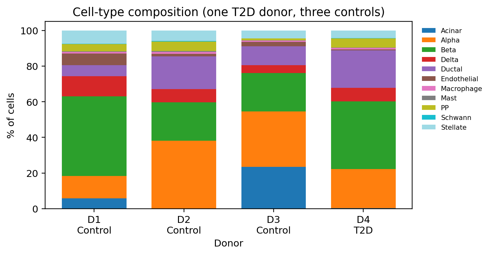
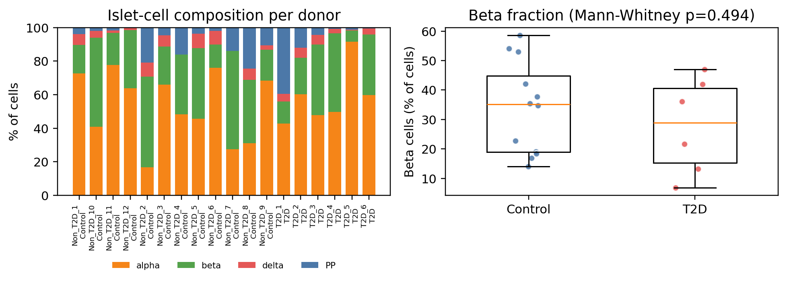

## 本章目标

1. 会用“每名供者内比例”而不是“所有细胞混在一起”描述组成；
2. 理解组成数据的成分性质；
3. 能解释本教程的 β 比例结果，不过度解读。

<div class="callout why" markdown="1">
<span class="callout-title">为什么不能把所有细胞混在一起算比例</span>
如果 18 名供者中 T2D 组的细胞数更多，把所有细胞混在一起算比例，会被“细胞数多的供者”主导。正确做法是先算**每名供者**内的比例，再比较组间；统计单位仍是供者。
</div>

## 9.1 正确做法

- 先算每个供者内各类型的比例；
- 再比较组间（供者水平）；
- 组成数据是**成分数据**（总和为 1），普通 t 检验/ANOVA 不完全适用；可用 CLR/ILR、scCODA、propeller；
- 报告绝对细胞数 + 比例 + 供者数；
- 把“胰岛纯度/解离效率”作为协变量或限制条件。

```python
comp = pd.crosstab(adata.obs["donor"], adata.obs["cell_type"])
comp_pct = comp.div(comp.sum(axis=1), axis=0) * 100
```

## 9.2 Baron 的结果（只做描述）

| 供者 | 条件 | β 比例 | 腺泡比例 |
|---|---|---:|---:|
| D1 | 对照 | 44.8% | 5.8% |
| D2 | 对照 | 21.6% | 0.1% |
| D3 | 对照 | 21.5% | 23.4% |
| D4 | T2D | 37.9% | 0.4% |

β 比例在 4 名供者间波动很大（21.5%–44.8%），腺泡比例从 0.1% 到 23.4%。这更可能反映**胰岛制备纯度/解离差异**，而不是疾病。

只有 1 名 T2D 供者，不能做组间统计；这里只展示，不做检验。



<figcaption>GSE84133 每名供者的细胞类型组成。D2 几乎无腺泡，D3 腺泡占 23.4%，提示胰岛纯度差异。</figcaption>

## 9.3 GSE81608 的结果

12 名对照 vs 6 名 T2D：

- 对照 β 比例中位数 **35.1%**；
- T2D β 比例中位数 **28.9%**；
- Mann-Whitney **p = 0.494**。

没有证据表明两组 β 比例不同。但要注意：

- 这是分选/处理后的细胞，不一定代表组织原位比例；
- 供者数只有 18；
- 分选策略、细胞活力、解离效率都可能影响比例；
- 组成分析不能替代功能实验。



<figcaption>GSE81608 的组成与 β 比例。左：每名供者的 α/β/δ/PP 比例；右：β 比例的组间比较（Mann-Whitney p=0.494）。</figcaption>

## 9.4 预期结果与解读

<div class="callout expected" markdown="1">
<span class="callout-title">你应该看到</span>
- Baron：D1 β 44.8%、D2 21.6%、D3 21.5%、D4 37.9%；腺泡 0.1%–23.4%；
- GSE81608：对照 β 中位数 35.1%，T2D 28.9%，p=0.494；
- 两张图都按供者展示，而不是把所有细胞合并。
</div>

**可以写**：

> “在本数据中，β 细胞比例在对照组中位数为 35.1%，T2D 组为 28.9%，差异无统计学意义（Mann-Whitney p=0.49，12 vs 6 名供者）。比例受胰岛纯度和解离效率影响，需在更大样本中验证。”

**不要写**：

> “T2D 导致 β 细胞比例下降。”——p=0.49，且没有调整纯度。

<div class="callout check" markdown="1">
<span class="callout-title">检查点</span>
**Q1**：为什么组成分析的 n 是供者数，而不是细胞数？

**Q2**：Baron 的 D2 腺泡只有 0.1%，最可能的原因是什么？

**Q3**：如果 T2D 组 β 比例更低但 p=0.49，你应该怎么报告？

<details><summary>参考答案</summary>

1. 每名供者是一个独立样本；细胞数增加的是精度，不是重复数。
2. 胰岛制备纯度高/腺泡丢失，或解离偏好；不是“D2 没有腺泡”。
3. 报告中位数、供者数、检验方法和 p 值，说明“无统计学意义”，不要写成“下降”。

</details>
</div>

## 下一步

组成分析回答“谁多谁少”；下一步回答“同一类细胞内部，哪些基因变了”。这是全教程统计上最关键的一章：为什么必须做 pseudobulk。
