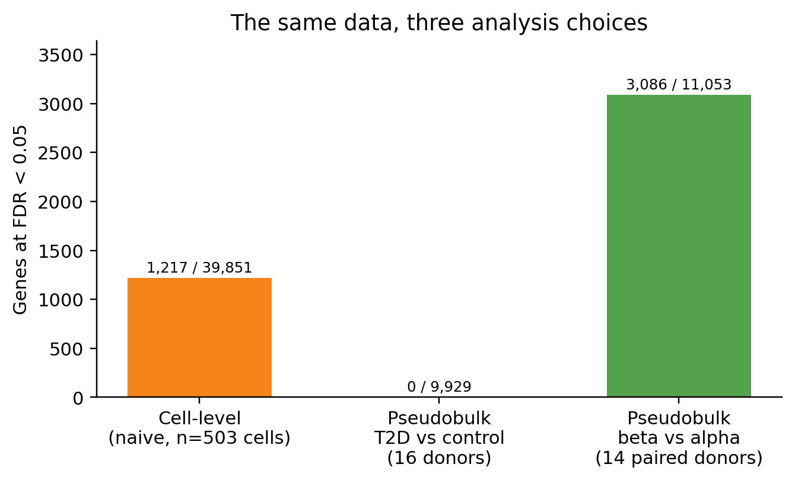
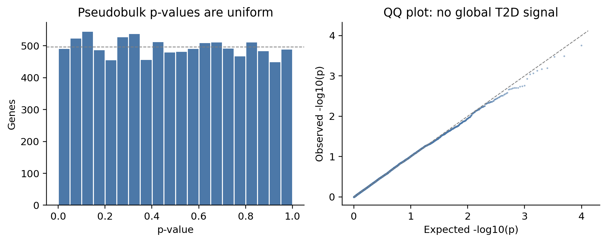

## 本章目标

1. 能解释为什么细胞水平 t 检验会严重夸大显著性；
2. 会按“供者 × 细胞类型”聚合，拟合带协变量的模型；
3. 复现本教程的三个数字：**1,217 / 0 / 3,086**；
4. 能读懂 p 值 QQ 图和阳性对照。

<div class="callout why" markdown="1">
<span class="callout-title">为什么这是全教程最重要的一章</span>
单细胞论文里最常见的统计错误，就是把每个细胞当独立样本。它会让 p 值变得极小、让审稿人无法判断效应是否真实。**pseudobulk + 供者水平协变量**是目前最稳健、最容易解释的做法之一。
</div>

## 10.1 伪重复：一个真实的反例

GSE81608 有 18 名供者、503 个 β 细胞。先做一次**故意错误**的细胞水平 t 检验：

```python
X = np.log2(beta.layers["rpkm"].toarray() + 1)
is_t2d = (beta.obs["condition"] == "T2D").to_numpy()
t, p = stats.ttest_ind(X[is_t2d], X[~is_t2d], axis=0, equal_var=False)
padj = multipletests(np.nan_to_num(p, nan=1.0), method="fdr_bh")[1]
print((padj < 0.05).sum())
```

**预期输出**：

```text
[naive cell-level] 1,217/39,851 genes at FDR<0.05
```

这 1,217 个基因里包括 `XIST`（性别）、`ND3`（线粒体）、大量 lncRNA/假基因——它们反映的是供者/技术差异，不是 T2D 效应。

## 10.2 正确做法：供者水平 pseudobulk

1. 选定细胞类型（β）；
2. 每名供者内，对该类型的 RPKM 取平均；
3. 得到“供者 × 基因”矩阵（16 × 39,851）；
4. 每个基因拟合：

```text
log2(RPKM_ij + 1) = β0 + β1·T2D + β2·age_z + β3·male + ε
```

5. 对 β1 做 t 检验，BH 校正；报告效应量 + FDR。

为什么是 16 名供者？因为只保留有 ≥10 个 β 细胞的供者：10 名对照 + 6 名 T2D。两名对照（β 细胞 <10）被排除。

```python
X = np.column_stack([np.ones(n), is_t2d, age_z, is_male])
coef, *_ = np.linalg.lstsq(X, Y, rcond=None)   # Y: donors x genes
resid = Y - X @ coef
se = np.sqrt((resid**2).sum(0) / (n - rank) * np.linalg.inv(X.T @ X)[1, 1])
t = coef[1] / se
p = 2 * stats.t.sf(np.abs(t), n - rank)
padj = multipletests(np.nan_to_num(p, nan=1.0), method="fdr_bh")[1]
```

**预期输出**：

```text
beta cells: 503
genes tested: 9,929 / 39,851
DE at FDR<0.05 & |log2FC|>0.5: 0 (0 up, 0 down)
```

最小 FDR ≈ **0.95**；p 值分布接近均匀。

## 10.3 三种分析的对照

| 分析 | 基因数 | FDR<0.05 |
|---|---:|---:|
| 细胞水平朴素 t 检验（错误） | 39,851 | **1,217** |
| 供者水平 pseudobulk（正确） | 9,929 | **0** |
| 阳性对照：β vs α pseudobulk | 11,053 | **3,086** |



<figcaption>同一份数据，三种分析选择。细胞水平检验产生大量假阳性；pseudobulk 没有显著基因；β vs α 阳性对照有 3,086 个，说明流程有检验效能。</figcaption>

## 10.4 为什么会是 0？先看 p 值诊断



<figcaption>左：p 值直方图接近均匀；右：QQ 图贴对角线。没有全局 T2D 信号。</figcaption>

如果 p 值分布偏离均匀（大量接近 0），说明有信号；本数据没有。这个结论比“跑出 0 个基因”更可靠，因为它不依赖某一个阈值。

## 10.5 阳性对照：β vs α

为了证明“0 个”不是因为流程坏了，做 β vs α 的 pseudobulk 比较（14 名同时有 ≥10 个 α 和 ≥10 个 β 细胞的供者，配对 t 检验）：

**预期输出**：

```text
[positive control beta vs alpha] 3,086/11,053 genes at FDR<0.05, 14 paired donors
INS +10.05, IAPP +9.72, GCG -8.79, DLK1 +7.25, DPP4 -4.64
```

这些完全符合 β/α 的生物学身份。阳性对照 + 阴性结果一起说明：

> 流程有检验效能，但 T2D 的全局差异在本数据/本模型下不可检出。

## 10.6 为什么和原论文的 245 个基因不一样？

Xin 等（2016）报告了 245 个 T2D 相关基因。我们的再分析得到 0 个，可能原因：

1. **分析单位不同**：原文可能使用细胞水平模型/混合模型；我们用保守的供者水平 pseudobulk。
2. **数据版本不同**：论文报告 1,492 个细胞，GEO 矩阵 1,600 列；作者过滤可能不同。
3. **协变量不同**：我们调整年龄和性别；T2D 组年龄均值偏高（45.7 vs 41.2 岁）。
4. **RPKM 的限制**：不是 UMI counts，无法做 counts-based 模型。
5. **阈值不同**：我们要求 FDR<0.05；原文可能报告 nominal p 或不同 FDR。
6. **样本量/效能**：16 名供者、6 名 T2D，对中等效应仍可能不足。

> 这不是“原论文错了”，而是**分析选择会改变结论**。可复现研究应报告数据版本、细胞筛选、协变量、模型、FDR 阈值，以及阴性/阳性对照。

## 10.7 排错表

| 现象 | 可能原因 | 处理 |
|---|---|---|
| `LinAlgError: Incompatible dimensions` | Y 的维度是 genes × donors | 改成 donors × genes，再 `lstsq(X, Y)` |
| 所有 p 值都是 NaN | 基因方差为 0 / 有 NaN | `np.nan_to_num(p, nan=1.0)`；过滤低表达基因 |
| 0 个显著，阳性对照也 0 个 | 聚合/模型/标签错了 | 先检查 β vs α 阳性对照 |
| 显著基因全是 XIST/ND3/lncRNA | 细胞水平伪重复/混杂 | 改 pseudobulk；调整性别/批次 |
| 效应量很大但 FDR 不显著 | 供者少/方差大 | 报告效应量和 CI；不要降 FDR 阈值 |

<div class="callout check" markdown="1">
<span class="callout-title">检查点</span>
**Q1**：为什么 pseudobulk 的 n 是 16，而不是 503？

**Q2**：p 值 QQ 图贴对角线说明什么？

**Q3**：如果阳性对照也只有 0 个显著基因，你会先查什么？

**Q4**：可以把 FDR 阈值从 0.05 改成 0.1 来“找到基因”吗？

<details><summary>参考答案</summary>

1. 503 是细胞数；pseudobulk 每名供者一个点，16 名有 ≥10 个 β 细胞的供者才是独立重复。
2. 观测 p 值分布与零假设下的均匀分布一致，没有全局差异信号。
3. 先查聚合是否正确（β/α 标签、供者列）、Y 方向、模型矩阵、是否 log/归一化；阳性对照是流程的“灯泡”。
4. 不可以先看结果再改阈值；阈值应预设。可以报告不同阈值的敏感性分析，但不能把 0.1 当主结果。

</details>
</div>

## 下一步

得到阴性结果后，下一步不是“换个阈值再试”，而是解释它能说明什么、不能说明什么，以及如何写进论文/毕业论文。
