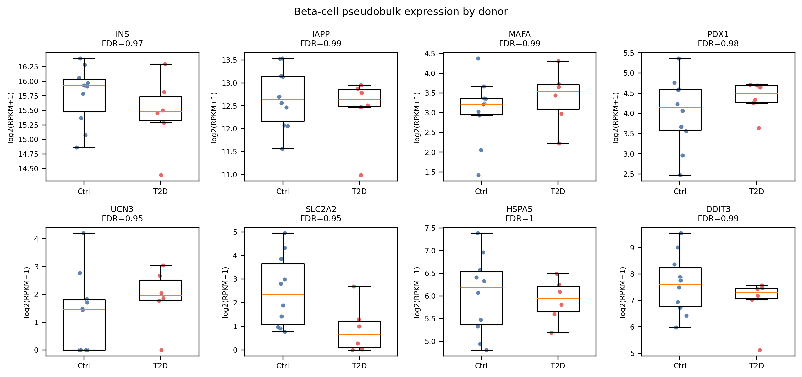

## 本章目标

1. 能区分“没有统计学显著”与“没有生物学效应”；
2. 会用阳性对照/阴性对照支撑结论；
3. 能写出一段不夸大的 Results 和 Limitations。

为什么阴性结果也值得写
阴性结果告诉我们“当前证据不足以支持某个效应”，这对后续样本量设计和假说修正很重要。把 0 个基因包装成“T2D 没有影响”，或者悄悄换阈值直到显著，都会损害研究的可信度。

## 11.1 可以说 vs 不能说

### 可以说

- 在这份数据中，人类胰岛包含 α、β、δ、PP、腺泡、导管、内皮、星状、巨噬、肥大、Schwann 等细胞类型；marker 注释与作者标签高度一致（ARI 0.968）。
- β 细胞存在 ER 应激相关状态（DDIT3/HSPA5/HERPUD1 高表达），与 Baron 原文报道的 β 异质性一致。
- 在 GSE81608 的 16 名供者中，未检出 β 细胞 T2D vs 对照的全局表达差异；β 比例差异也无统计学意义（p=0.494）。
- 细胞水平检验会产生大量假阳性；pseudobulk/混合模型是更合适的推断方式。

### 不能说

- “T2D 对 β 细胞没有影响”——阴性结果不等于无效应。
- “我们发现了 T2D 的关键基因”——本分析没有显著基因。
- “β 比例在 T2D 中下降”——p=0.494，且受分选/纯度影响。
- “GSE84133 的 D4 与对照的差异是糖尿病效应”——只有 1 名 T2D 供者，完全与供者/批次共线。

## 11.2 证据强度表

| 结论 | 证据 | 强度 |
|---|---|---|
| 11 类胰岛/胰腺细胞 | 聚类 + marker + ARI 0.968 | 中等（描述性） |
| β 细胞 ER 应激亚群 | DDIT3/HSPA5/HERPUD1 + 作者异质性 | 中等（关联） |
| T2D β 比例下降 | 35.1% vs 28.9%，p=0.494 | 不支持 |
| T2D β 全局表达差异 | pseudobulk 0/9,929；阳性对照 3,086 | 不支持（本数据/本模型） |
| T2D 对 β 细胞无影响 | 阴性结果 | **不能下结论** |

## 11.3 一段可发表的 Results 示例

> “We re-analysed 1,600 single cells from 18 donors (12 non-diabetic, 6 T2D). After donor-level pseudobulk aggregation, 16 donors with at least 10 β cells were retained (10 control, 6 T2D). Using a linear model adjusted for age and sex, no gene passed FDR < 0.05 (0/9,929; minimum FDR = 0.95). The p-value distribution was consistent with the null (QQ plot). As a positive control, the same pipeline identified 3,086/11,053 genes differentially expressed between β and α cells (e.g., INS +10.05, GCG −8.79), indicating adequate power to detect strong cell-identity effects. We therefore conclude that this dataset does not provide evidence for a global β-cell transcriptional difference between T2D and control donors; the analysis cannot exclude smaller or cell-state-specific effects.”

注意这段话做了四件事：

1. 说明数据和分析单位；
2. 报告阴性结果和最小 FDR；
3. 用阳性对照证明流程有效能；
4. 明确限制（不能排除小效应/状态特异效应）。

## 11.4 Limitations 应该怎么写

- 样本量：16 名供者、6 名 T2D，对中等效应效能不足；
- 数据层级：RPKM 不是 counts，无法做 counts-based 模型；
- 批次/混杂：年龄、性别、BMI、胰岛纯度、批次信息有限；
- 细胞类型：只分析 β 细胞，未覆盖其他类型/状态；
- 技术：无空液滴/双细胞/环境 RNA 校正；
- 统计：pseudobulk 可能平均掉细胞状态异质性；
- 验证：没有独立队列/蛋白/功能验证。

<figcaption>β 身份基因与 ER 应激基因在 T2D/对照间均无显著差异（FDR 0.95–1.0）。这是“阴性结果”的直观呈现，不是“T2D 没有影响”。</figcaption>

## 11.5 如果审稿人说“你们为什么不用细胞水平检验”

可以回答：

> “细胞水平检验把同一供者的细胞视为独立重复，违反独立性假设，会低估标准误。我们使用供者水平 pseudobulk，并以阳性对照（β vs α）验证流程效能；细胞水平结果作为敏感性分析附在补充材料中，显示 1,217 个基因‘显著’，主要由伪重复驱动。”

这比争论“哪个 p 值更小”更有说服力。

检查点
**Q1**：0 个显著基因，能不能说“T2D 对 β 细胞没有影响”？

**Q2**：阳性对照在论文里应该放主图还是补充图？

**Q3**：如果审稿人要求“再跑一个细胞水平 DE”，你怎么处理？

参考答案

1. 不能。只能说“本数据/本模型未检出全局差异”，不能排除小效应/状态特异效应。
2. 建议放主图或至少正文引用：它是“流程有检验效能”的关键证据；详细基因表可放补充。
3. 可以作为敏感性分析报告，但同时说明伪重复问题，并坚持 pseudobulk 为主分析；不要用细胞水平 p 值替代主结论。

## 下一步

最后一步把项目变成“别人能重跑”的研究：目录、环境、随机种子、版本、检查清单，以及下一步的学习路线。
